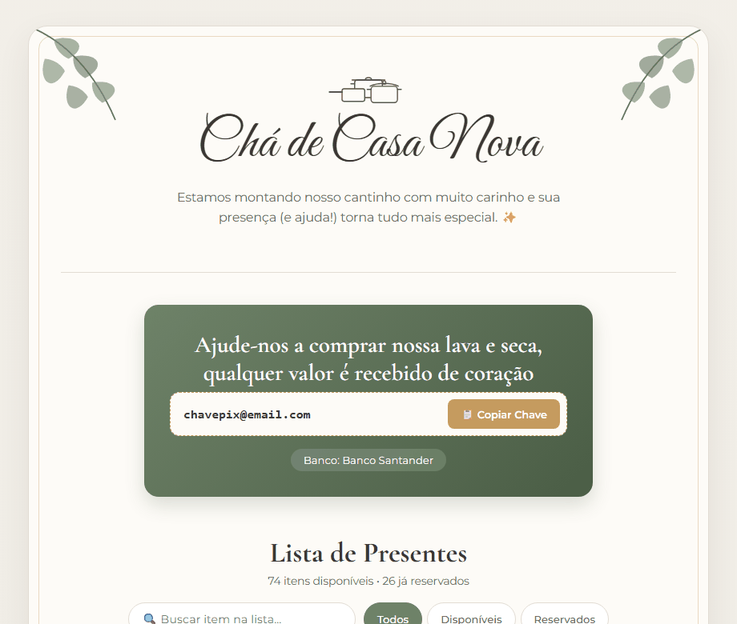
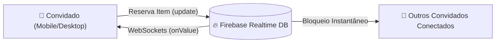

# 🏡 Sistema Web de Lista de Presentes em Tempo Real — Chá de Casa Nova

> 🔗 **[Acesse a Demonstração Interativa ao Vivo](https://luanluizifrs.github.io/cha-de-casa-nova/)**

---

## 🎯 O Projeto (Visão de Negócio)

Este projeto nasceu de uma demanda real de clientes que estavam organizando seu **Chá de Casa Nova** e enfrentavam dois grandes problemas comuns nesse tipo de evento:

1. **A desorganização das listas manuais:** Organizar dezenas de itens em planilhas compartilhadas ou grupos de WhatsApp gera atrito para os convidados, falta de atualização instantânea e o clássico problema de **presentes repetidos**.
2. **As taxas abusivas de plataformas prontas:** Sites tradicionais de listas de casamento e chá de panela costumam reter de **6% a 10% de taxa** sobre os valores recebidos pelos anfitriões, além de obrigarem o convidado a passar por cadastros longos e checkouts complexos.

### 💡 A Solução Entregue
Desenvolvi uma aplicação web sob medida, 100% alinhada à identidade visual e paleta de cores do convite físico dos clientes. A plataforma centraliza **100 itens curados** com links diretos de compra, bloqueio automático em tempo real assim que um convidado confirma a reserva e integração direta com a chave **PIX dos anfitriões (taxa zero)** — entregando uma experiência fluida, sem necessidade de login ou senha para os convidados.

---

## 🏗️ Arquitetura e Tecnologias

A arquitetura foi projetada sob o princípio de **eficiência máxima e custo zero de infraestrutura**, priorizando carregamento instantâneo em redes móveis (3G/4G), já que mais de 90% dos convidados acessam o link diretamente pelo celular via WhatsApp:

- **Frontend (HTML5, CSS3 & JavaScript Vanilla ES6+):**
  Construído sem frameworks pesados para eliminar *bundle overhead* e garantir *First Contentful Paint (FCP)* imediato. Utiliza variáveis CSS (`:root`) para tematização botânica/clássica, *CSS Grid/Flexbox* para layout adaptativo, ilustrações vetoriais (`SVG`) inline e manipulação reativa do DOM.
- **Backend & Concorrência (Firebase Realtime Database — SDK Modular v10.8.1):**
  Para resolver o problema de **concorrência de cliques simultâneos** (dois convidados olhando a lista ao mesmo tempo), a aplicação mantém uma conexão ativa via WebSockets utilizando o listener `onValue`. Quando um convidado confirma um presente através da operação atômica `update`, o estado é propagado em milissegundos para todos os dispositivos conectados, bloqueando o item imediatamente sem necessidade de recarregar a página (*F5*).
- **Infraestrutura e Deploy (Netlify & GitHub Pages):**
  Hospedagem em CDN global com HTTPS nativo e pipeline de **CI/CD automatizado** integrado ao Git, garantindo alta disponibilidade e atualizações instantâneas a cada *push*.

---

## ✨ Principais Funcionalidades

- 🔒 **Bloqueio Dinâmico de Itens em Tempo Real:** Ao clicar em *"Marcar como presente"*, um modal solicita a identificação do convidado e registra a reserva ao vivo, alterando o status visual do card para indisponível e exibindo quem presenteou.
- 💸 **Integração Visual com PIX (Copy-to-Clipboard):** Destaque estratégico para contribuição financeira direta via PIX (sem intermediários), contando com botão de cópia rápida via `navigator.clipboard` e feedback visual imediato (`✅ Copiado!`).
- 🔍 **Busca Instantânea e Filtros de Estado:** Barra de pesquisa em tempo real por nome do produto e filtros rápidos por categoria de disponibilidade (*Todos*, *Disponíveis* e *Reservados*), acompanhados de um contador dinâmico de progresso da lista.
- 🛍️ **Curadoria com Links Diretos:** Integração direta de 100 produtos selecionados pelos anfitriões, permitindo que o convidado visualize a referência exata do item com apenas um toque.
- 📱 **Design Responsivo (Mobile-First) & Identidade Sob Medida:** Tipografia clássica combinada com estética botânica, contornos dourados e micro-interações pensadas para facilitar o uso por convidados de todas as faixas etárias.

---

## 🤝 Serviços Freelance — Vamos Construir Seu Projeto?

Sou **Engenheiro de Software** focado em transformar problemas reais em produtos digitais rápidos, elegantes e orientados a resultado. 

Estou com a **agenda aberta para projetos freelance e desenvolvimento de soluções web sob medida**, incluindo:
- Páginas interativas para eventos (**Casamentos, Chá de Casa Nova, Chá de Bebê, Aniversários**) com lista de presentes em tempo real e PIX sem taxas;
- **Landing Pages** de alta conversão e sistemas web personalizados para negócios locais e profissionais liberais;
- Aplicações Front-end e integrações em tempo real.

📬 **Entre em contato comigo:**
- **GitHub:** [github.com/luanluizifrs](https://github.com/luanluizifrs)
- **LinkedIn:** [Link do LinkedIn]
